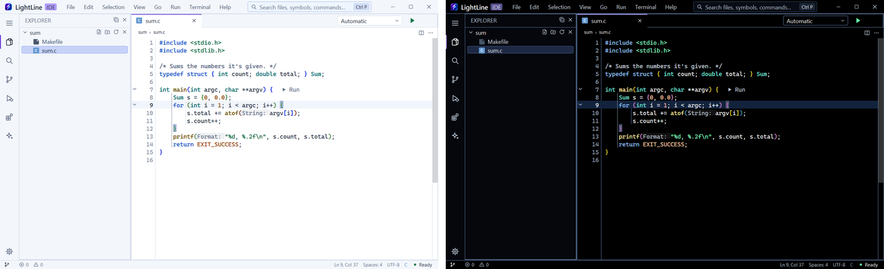

# LightLine Extensions

LightLine's own extensions, made and tested for [LightLine](https://github.com/mehmoodulhaq570/LightLine), the fast native code editor for Windows.

Install them from LightLine: open **Extensions** (`Ctrl+Shift+X`). They're listed under **Recommended** with the **LightLine** badge. LightLine downloads only the extension's own folder, at the exact commit its list pins.

| Extension | Kind | What it gives you |
| --- | --- | --- |
| [LightLine Themes](themes/lightline-themes) | Color theme | **LightLine Daylight** (light) and **LightLine Contrast** (high contrast), made to match LightLine's built-in Midnight |
| [C and C++ Snippets](snippets/lightline-c-snippets) | Snippets | `main`, `for`, `struct`, `class`, include guards, `malloc` and `fopen` with their checks, and more |



## What's in this repository

```
themes/<id>/        color themes
snippets/<id>/      snippet packs
template/           a starting point for a new extension of each kind
scripts/check.py    the checks CI runs on every push and pull request
```

Every extension is in [Zed's extension format](https://zed.dev/docs/extensions) (`extension.toml`, `themes/`, `snippets`), so it works in LightLine today and could be offered to Zed's registry later. Its folder name is its id, and every id starts with `lightline-`.

## Contributing

See [CONTRIBUTING.md](CONTRIBUTING.md). In short: copy a folder from `template/`, run `python scripts/check.py`, and open a pull request.

## License

[MIT](LICENSE), the same as LightLine.
