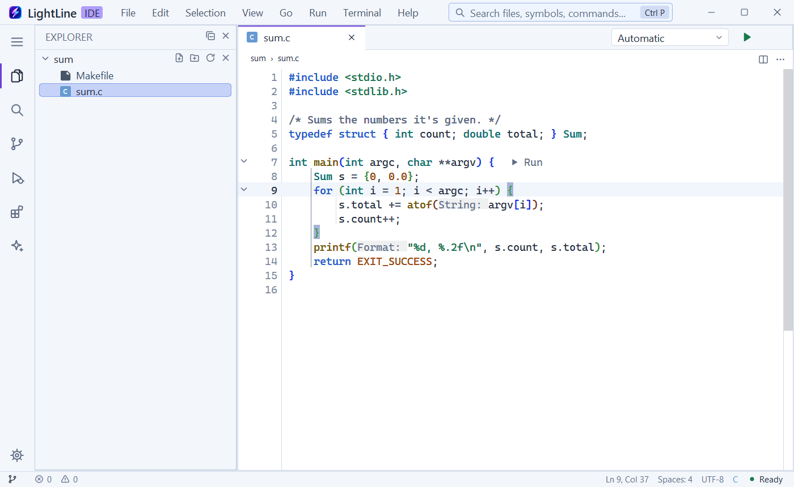
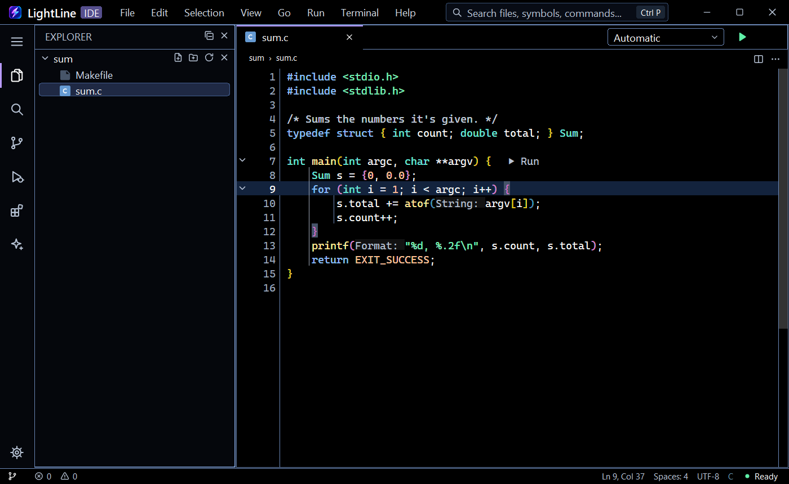

# LightLine Themes

Two color themes made to match LightLine Midnight, LightLine's built-in dark theme:

- **LightLine Daylight**: a light theme. A white editor and cool grey chrome. Every code color stands out from the background by at least 4.5:1 (WCAG AA), including on the caret line.
- **LightLine Contrast**: a high-contrast dark theme. Black, white and bright edges. Every code color stands out from the background by at least 7:1 (WCAG AAA).

Install from LightLine's Extensions panel, then pick a variant with the color theme picker.

